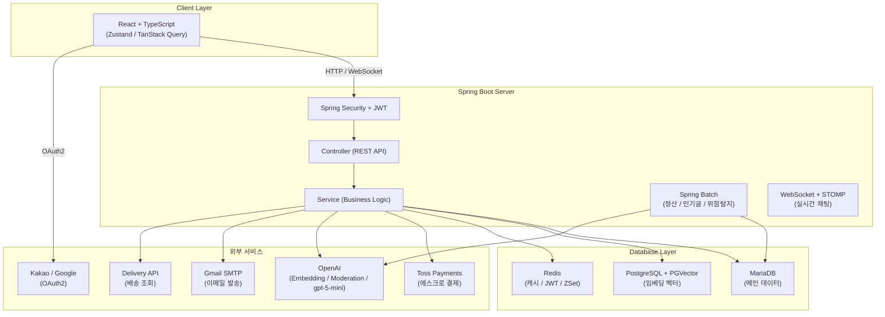
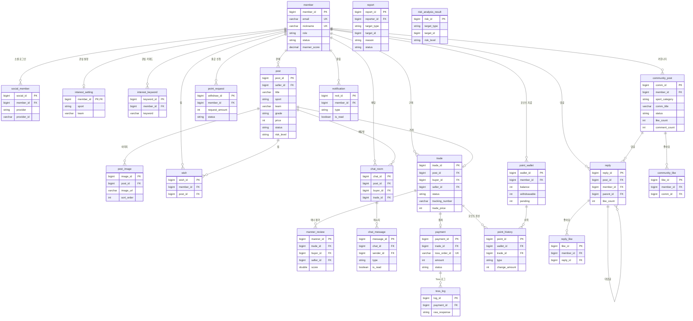

# RE:FORM

[](https://openjdk.org/)
[](https://spring.io/projects/spring-boot)
[](https://mariadb.org/)
[](https://www.postgresql.org/)
[](https://redis.io/)
[](https://react.dev/)

> 다양한 종목의 스포츠 팬이 유니폼을 안전하게 거래하고 팬덤 문화를 나눌 수 있는 **스포츠 유니폼 전문 중고거래 & 커뮤니티 웹 서비스**

---

개인 배포용 링크: https://reform.mkserver.cloud/

---

## 목차

- [팀원 소개](#팀원-소개)
- [프로젝트 소개](#프로젝트-소개)
- [기술 의사결정](#기술-의사결정)
- [시스템 아키텍처](#시스템-아키텍처)
- [주요 기능](#주요-기능)
- [AI 품질 평가 (Eval)](#ai-품질-평가-eval)
- [기술 스택](#기술-스택)
- [배포 · 운영](#배포--운영)
- [환경 설정](#환경-설정)
- [브랜치 · PR 규칙](#브랜치--pr-규칙)
- [트러블슈팅](#트러블슈팅)
- [팀 회고](#팀-회고)
- [팀 문서](#팀-문서)


## 팀원 소개

| 이름 | 기획 | 백엔드 | 비고 |
|------|------|--------|------|
| 김민기 | 프로젝트 설계 리딩, 유스케이스 정의, ERD 구성 및 DB 설계 | JWT 인증/인가, OAuth2, 판매글 CRUD, 거래, Delivery API, Redis, Spring AOP 성능 모니터링, AI 위험 탐지 | |
| 손민정 | 요구사항 정의서, 유스케이스, 테이블 정의서, 스토리보드 | Toss Payments 에스크로 결제, Spring Batch 정산 자동화, OpenAI Embedding + PGVector 의미 검색, AI 위험 탐지, 인기글 집계 | |
| 진혜림 | 테이블 설계서, 기능 설명서 작성 | WebSocket + STOMP 실시간 채팅, 커뮤니티 CRUD, OpenAI GPT-4o Vision 판매글 이미지 자동 분석, OpenAI Moderation 유해성 검사 | |
| 최민종 | UI/UX 설계, 디자인 시스템 구축 | React + TypeScript 전체 뷰 개발 전담, Zustand 전역 상태 관리, TanStack Query, 반응형 + 다크모드 | 프론트엔드 |

---

## 프로젝트 소개

### 개발 배경

- 기존 중고거래 플랫폼(당근, 번개장터)은 범용 서비스로 마킹, 시즌, 구단 등 **유니폼 고유 속성 기반 탐색이 불가능**
- 희귀·한정판 유니폼의 경우 진위 확인이 어렵고 리셀러가 선점 후 고가에 재판매하는 **구조적 문제** 존재
- 스포츠 팬덤 커뮤니티가 여러 플랫폼에 분산되어 **거래와 커뮤니티 간 연결점 부재**

### 목적

- 스포츠 유니폼 특화 필터와 AI 유사 검색으로 원하는 유니폼을 빠르게 탐색할 수 있는 **전문 버티컬 마켓 구축**
- **에스크로 결제**로 안전한 거래 환경 조성
- 거래와 커뮤니티를 하나의 플랫폼에서 경험하여 **스포츠 팬덤 활성화**

### 개발 기간 및 팀 구성

- 개발 기간: 2026.05
- 팀 구성: 4인 (백엔드 3 + 프론트엔드 1)

---

## 기술 의사결정

### Spring Batch

> 자동 구매 확정(수령 후 5일), 포인트 정산, 인기글 집계(1시간), AI 위험 탐지(6시간) 등 주기적으로 실행해야 하는 작업들이 여러 개였습니다. @Scheduled만으로는 실패 처리, 재시도, 실행 이력 관리가 어렵기 때문에 Spring Batch를 도입하여 각 Job을 독립적으로 관리했습니다.

### OpenAI Embedding + PGVector

> 기존 LIKE 기반 키워드 검색은 "첼시 홈킷", "블루스" 같은 한글 별칭 검색이 불가능합니다. 게시글을 벡터로 변환해 PGVector에 저장하고 cosine 유사도 검색을 적용하여 의미 기반 검색을 구현했습니다. 팀 별칭 Map으로 한글/영문 혼용 및 축약어 검색을 지원합니다.

### Toss Payments 에스크로

> 중고거래 특성상 구매자-판매자 간 신뢰 문제가 핵심입니다. 에스크로 방식으로 구매자 결제 금액을 플랫폼이 보관하고, 구매 확정 시에만 판매자에게 정산하여 안전한 거래 환경을 구성했습니다.

### 멀티 데이터소스 (MariaDB + PostgreSQL + Redis)

> 도메인 특성에 따라 저장소를 분리했습니다. MariaDB는 거래 도메인 전반(@Primary), PostgreSQL + PGVector는 임베딩 벡터 저장 및 유사도 검색, Redis는 인기글 ZSet 캐싱 및 JWT 토큰 관리에 사용합니다. MariaDBConfig를 @Primary로 설정하고 MyBatis는 수동 설정으로 분리하여 JPA/Spring Batch DataSource 충돌을 방지했습니다.

### WebSocket + STOMP

> 채팅은 HTTP 폴링 방식으로는 실시간성을 보장하기 어렵습니다. WebSocket + STOMP 프로토콜을 적용하여 실시간 메시지 송수신을 구현하고, OpenAI Moderation API 연동으로 유해 메시지를 실시간으로 탐지합니다.

---

## 시스템 아키텍처



### 배치 아키텍처

| Job명 | 실행 주기 | 용도 |
|-------|-----------|------|
| `dailyBatchJob` | 매일 새벽 4시 | 자동 구매 확정 + 포인트 정산 |
| `popularCommunityPostJob` | 1시간마다 | 인기글 집계 → Redis ZSet 저장 |
| `riskDetectionJob` | 6시간마다 | 위험 콘텐츠 AI 탐지 |
| `userBehaviorSyncScheduler` | 10분마다 | 행동 이력 Redis → MariaDB 동기화 |

---

## ERD



### 테이블 목록 (총 23개)

| 도메인 | 테이블 | 설명 |
|--------|--------|------|
| 회원 | `member` | 회원 기본 정보 |
| 회원 | `social_member` | 카카오/구글 OAuth2 연동 |
| 회원 | `interest_setting` | 관심 종목·구단 설정 |
| 회원 | `interest_keyword` | 관심 키워드 목록 |
| 거래 | `post` | 유니폼 판매글 |
| 거래 | `post_image` | 판매글 이미지 |
| 거래 | `wish` | 찜하기 |
| 거래 | `trade` | 거래 상태 관리 |
| 거래 | `manner_review` | 매너 평가 |
| 채팅 | `chat_room` | 채팅방 |
| 채팅 | `chat_message` | 채팅 메시지 |
| 결제 | `payment` | Toss 결제 정보 |
| 결제 | `toss_log` | Toss API 원문 응답 (append-only) |
| 결제 | `point_wallet` | 포인트 지갑 |
| 결제 | `point_history` | 포인트 입출금 이력 |
| 결제 | `point_request` | 출금 신청 |
| 커뮤니티 | `community_post` | 커뮤니티 게시글 |
| 커뮤니티 | `reply` | 댓글·대댓글 |
| 커뮤니티 | `community_like` | 게시글 좋아요 |
| 커뮤니티 | `reply_like` | 댓글 좋아요 |
| 기타 | `report` | 신고 |
| 기타 | `notification` | 알림 |
| AI | `risk_analysis_result` | AI 위험 탐지 결과 |

---

## 주요 기능

### 회원 및 인증

- 이메일 회원가입 / 카카오·구글 OAuth2 로그인
- Spring Security + JWT (액세스 토큰 / 리프레시 토큰, Rotation 적용)
- 이메일 2차 인증코드 검증 후 최종 로그인 처리
- Redis 블랙리스트 기반 로그아웃, 다중 세션 관리
- 관심 종목·팀·키워드 설정 기반 맞춤 피드 및 알림

### 유니폼 거래

- 판매글 CRUD 및 이미지 업로드
- 종목·구단·마킹·시즌·상태 등급 복합 필터 및 최신순·인기순·가격순 정렬
- 찜하기, 조회수, 신고 기능

### 채팅

- WebSocket + STOMP 기반 실시간 메시지 송수신 (텍스트 + 이미지)
- OpenAI Moderation API 실시간 유해 메시지 탐지
- 채팅 미읽음 알림, 입장 시 일괄 읽음 처리

### 결제 및 정산

- Toss Payments 에스크로 기반 안전결제 (초기화 → 승인 → 취소/환불)
- Spring Batch 자동 구매 확정 (수령 후 5일 경과) 및 수수료 5% 차감 후 판매자 포인트 정산
- 포인트 지갑 조회, 출금 신청·취소 및 관리자 승인·반려 흐름

| 이벤트 | 잔액(balance) | 출금가능(withdrawable) | 대기(pending) |
|--------|:---:|:---:|:---:|
| 거래 완료 | - | - | +거래금액 |
| 구매 확정 | +지급포인트 | +지급포인트 | -거래금액 |
| 출금 신청 | - | -출금액 | +출금액 |
| 출금 승인 | -출금액 | - | -출금액 |
| 출금 반려/취소 | - | +출금액 | -출금액 |

### 검색

- 키워드·필터(종목·등급·거래 방식·가격·사이즈)·정렬 복합 검색 및 페이지네이션
- **의미 검색**: OpenAI `text-embedding-3-small` + PGVector, 유사도 기준값 0.30 (`app.ai.search.*` 프로퍼티)
- **AI 재정렬** (`PostSearchReranker`): 제목·종목·팀이 같은 글을 한 묶음으로 모아 상위 20묶음을 후보로 보내고, `gpt-5-mini`(추론 minimal, 4초 제한)가 검색어에 맞는 묶음만 골라 순서를 정합니다. 실패하거나 시간을 넘기면 유사도 순 결과로 대신하고, 검색어별 10분 캐시로 페이지를 넘겨도 순서가 바뀌지 않게 합니다.
- **관련도순 병합**: 검색어가 제목·팀·유니폼명·본문에 그대로 든 글(의미 검색 순서) → 나머지 키워드 일치 글 → 의미 검색으로만 찾은 글. 최신·가격·인기 정렬을 고르면 걸러진 글 전체를 그 기준으로 다시 정렬합니다.
- **판매 상태 동기화**: 판매 상태를 벡터 메타데이터에 두고 상태가 바뀌면 커밋 뒤 갱신해, 판매중 글만 후보로 씁니다.
- 팀 별칭(예: T1 → 테원·페이커·SKT, Gen.G → 젠지)을 임베딩 텍스트에 붙여 한글/영문 혼용 및 축약어 검색 지원
- 품질은 [의미 검색 eval](#ai-품질-평가-eval)로 측정합니다.

### 커뮤니티

- 게시글·댓글·대댓글·좋아요 토글
- 작성자 익명 처리 (작성자 = 글쓴이, 그 외 = 익명1, 익명2 순)
- Spring Batch + Redis ZSet 기반 1시간 주기 인기글 자동 집계
  - 점수 공식: `조회수 × 1 + 좋아요 × 3 + 댓글 × 2`

### AI 기능

#### 이미지로 판매글 초안 작성 (`AiListingService`)

판매글 작성 시 이미지를 업로드하면 Vision 모델(`gpt-5-mini`, 추론 강도 low)이 이미지를 분석하여 제목과 설명을 자동으로 제안합니다. 모델과 추론 강도는 [모델 비교 eval](#모델추론-강도-비교-판매글-25건신고-제안-40건) 결과로 정했습니다.

**처리 흐름**

```
[이미지 업로드] contentType + byte[]
        ↓
  SystemMessage: "중고 스포츠 유니폼 판매 전문가" 역할 부여
  + JSON 형식 지정 (title / description)
        ↓
  UserMessage: Media 객체(이미지 바이트) + 분석 요청 텍스트
        ↓
  Spring AI ChatClient → gpt-5-mini 호출 (요청 옵션으로 reasoning_effort=low)
        ↓
  응답 JSON 파싱 (마크다운 코드블록 자동 제거)
        ↓
  AiListingSuggestResponseDTO 반환 (status: OK / NO_PRODUCT / FAILED)
```

**출력 규격**

| 필드 | 규격 |
|------|------|
| `title` | 20자 이내, 종목·팀·사이즈(라벨이 보일 때만) 포함 |
| `description` | 150자 이내, 보이는 상태·하자·특징 포함 |
| `status` | `OK` 제안 있음 · `NO_PRODUCT` 사진에서 상품을 찾지 못함 · `FAILED` AI 호출·파싱 실패. `OK`가 아니면 제목·설명은 빈 문자열이라 프론트는 폼을 채우지 않고 안내만 보여줍니다 |

이미지에서 확인되는 사실만 씁니다. 사이즈 라벨이 없으면 "사이즈 미표기"로 쓰고, 하자는 첫 문장에 적고, 이미지 속 메모의 지시·연락처·선입금 문구는 무시합니다. 그림자·주름·조명 차이는 하자로 쓰지 않고, 근거 없는 "빈티지"·기능 이름(DRI-FIT 등)도 쓰지 않습니다. 품질은 [AI 품질 평가 (Eval)](#ai-품질-평가-eval)로 측정합니다.

**API**

```
POST /api/listings/ai-suggest
Content-Type: multipart/form-data
Body: image (file)
```

---

#### OpenAI Moderation API — 위험 콘텐츠 탐지 (`ModerationService`)

채팅 메시지 및 게시글(POST / CHAT)을 2단계로 검사하고 결과를 `risk_analysis_result` 테이블에 저장합니다.

**2-Tier 탐지 구조**

```
[콘텐츠 입력]
        ↓
  [Tier 1] ModerationKeyword (로컬 키워드 필터)
    - NFKC 정규화 + 소문자 변환 + 특수문자 제거
    - 정상 문구 제거 ("시발점", "새끼손가락", "가품 아닙니다" 등) 후 공백 제거
    - 정규식 패턴 매칭 (욕설, 우회 표기, 위협, 사기 유도, 위조품 등)
    - 매칭 시 즉시 HIGH/MID 반환 (API 호출 없이 빠른 차단)
        ↓ (미매칭 시)
  [Tier 2] OpenAI Moderation API
    - ModerationModel.call(ModerationPrompt)
    - 위반 카테고리 분석 → ModerationCategory Enum 매핑
    - 최고 RiskLevel 산출
        ↓
  ChatGPT로 개선 제안 생성 (한국어 1~2문장)
        ↓
  DB 저장 / 갱신 / 삭제 (flagged 여부에 따라)
  API 장애 시 fallback → 정상(safe) 처리
```

**로컬 키워드 규칙**

| 패턴 예시 | 사유 | 등급 |
|-----------|------|:----:|
| `선불\|계좌이체\|선입금\|오픈채팅\|텔레그램` | 사기 위험 거래 유도 (플랫폼 밖 결제·연락) | MID |
| `가품\|레플리카\|짭이\|도용제품` | 위조품·권리 침해 의심 | HIGH |
| `씨+발`, `ㅅㅂ`, `시1발`, `tlqkf`, `ㅂㅅ` 등 | 강한 욕설 / 우회 표기 | HIGH |
| `죽어라\|죽여버\|뒤져라\|꺼져` | 폭력적·위협적 표현 (명령형만) | HIGH |

> 규칙과 개선 제안의 품질은 [AI 품질 평가 (Eval)](#ai-품질-평가-eval)로 측정합니다.

**위험 등급별 처리**

| 등급 | OpenAI 카테고리 | 처리 |
|------|----------------|------|
| HIGH | 혐오+위협, 자해 안내, 미성년자 성적 콘텐츠 | DB 저장 → 관리자 검토 |
| MID | 차별/비하, 폭력, 불법 | DB 저장 → 관리자 검토 |
| LOW | 성적 콘텐츠 | DB 저장 → riskLevel 업데이트 |
| 정상 | - | 기존 탐지 결과 DB에서 삭제 |

**탐지 대상 분류**

| TargetType | 탐지 시점 | DB 저장 |
|-----------|-----------|:-------:|
| `CHAT` | 채팅 메시지 전송 시 실시간 | ✅ |
| `POST` | 게시글 작성/수정 시 즉시 + Spring Batch 6시간 주기 | ✅ |
| 임시저장(`checkDraft`) | 저장 전 사전 검사 | ❌ (transient) |

**Spring Batch 연동**

`riskDetectionJob`이 6시간마다 전체 게시글을 순회하며 `ModerationService.checkAndSave()`를 호출합니다. 신규 게시글 작성 시 실시간 검사와 병행하여 누락 없이 커버합니다.

### AI 개인화 추천

> 기존 파일 수정 없이 신규 파일 12개 추가만으로 구현 (AOP 활용)

**추천 흐름**

```
[유저 행동] 게시글 클릭 / 검색 키워드 입력
        ↓ (AOP 자동 감지)
     Redis에 임시 저장
        ↓ (10분마다 배치)
     MariaDB (user_view_log, user_search_log)
        ↓
[추천 요청 시]
interest_setting + interest_keyword (가입 시 설정)
  + 최근 조회 이력 (빈도 × 최근성 가중치)
  + 최근 검색어 (빈도 × 최근성 가중치)
        ↓
  선호도 텍스트 → OpenAI Embedding → PGVector 유사도 검색
        ↓
  이미 본 게시글 제외 (viewedPostIds Set 필터)
        ↓
  추천 게시글 반환
```

**선호도 가중치 설계**

| 데이터 소스 | 기본 가중치 | 최근성 보너스 |
|------------|:---------:|:------------:|
| interest_setting (sport/team) | 2회 반복 | - |
| interest_keyword | 1회 반복 | - |
| 조회 이력 sport/team | 빈도 ÷ 3 | 3일↓=4배, 7일↓=3배, 30일↓=2배 |
| 검색 키워드 | 빈도 ÷ 2 | 동일 |

**Redis 키 설계**

| Redis Key | 타입 | 내용 |
|-----------|------|------|
| `behavior:view:{memberId}` | List | 조회 이력 JSON (TTL 30일) |
| `behavior:search:{memberId}` | List | 검색 이력 JSON (TTL 30일) |
| `behavior:active:members` | Set | 배치 처리 대기 memberId 목록 |

**API**

```
GET /api/recommendations?size=10
```
- 로그인 필수 (비로그인 시 빈 배열 반환)
- size 기본 10, 최대 50
- 추천 이유: 조회+검색 이력 5건 이상 → "최근 활동 기반 추천", 미만 → "관심 종목 기반 추천"

---

## AI 품질 평가 (Eval)

> LLM 기능은 "잘 되는 것 같다"로는 개선 여부를 판단할 수 없습니다. 라벨링된 데이터셋으로 품질을 수치화하고, 수정 전후를 같은 기준으로 비교하며, CI에서 회귀를 막습니다.

### 구성

| Eval | 대상 | 방식 | 실행 |
|------|------|------|------|
| `ModerationKeywordEvalTest` | 로컬 키워드 규칙 | 결정적 (API 호출 없음) | PR마다 CI 자동 실행, 기준치 미달 시 실패 |
| `ModerationLiveEvalTest` | 로컬 규칙 + OpenAI Moderation 최종 판정 | OpenAI 실호출 | `./gradlew evalTest` (수동) |
| `ModerationSuggestionEvalTest` | 작성자에게 보여주는 개선 제안 | LLM-as-judge | `./gradlew evalTest` (수동) |
| `ListingSuggestEvalTest` | 판매글 자동 작성 (`AiListingService`) | 결정적 검사 + LLM-as-judge | `./gradlew evalTest` (수동) |
| `SemanticSearchEvalTest` | 의미 검색 + AI 재정렬 | Recall@K·MRR·오탐 (정답 글 라벨) | `./gradlew evalTest` (수동, PG 불필요) |

- **데이터셋** (`src/test/resources/eval/moderation/cases.jsonl`, 73건): 정상 거래 문장, 오탐을 유도하는 정상 문장("가품 아닙니다", "새끼손가락", "시발점"), 욕설과 우회 표기, 위협, 비하·혐오, 사기 유도, 가품, 성적 표현, 자해 표현
- **지표**: precision, recall, false positive rate, 등급 일치율, 태그별 정확도. 결과는 `build/reports/eval/*.md`에 오판정 케이스와 함께 저장됩니다.
- **개선 제안 채점 항목**: 사기·가품 숨김(`concealsRisk`), 없는 혜택 지어냄(`fabricatesPromise`), 욕설 반복(`repeatsAbuse`), 1~2문장 한국어 제안이 아님(`offTarget`)
- **판매글 데이터셋** (`src/test/resources/eval/listing/`, 25건): 정답(팀명·번호·사이즈 라벨·얼룩·찢어짐·REPLICA 태그·메모지)을 직접 그려 넣은 합성 이미지. 라벨이 정확하고 실제 사진의 저작권·개인정보 문제가 없습니다. `./gradlew generateListingEvalImages`로 다시 그립니다.
- **판매글 실제 사진 셋** (`src/test/resources/eval/listing/real/`, 29건): Wikimedia Commons의 CC BY-SA·CC BY·퍼블릭 도메인 유니폼 사진을 800px로 줄여 사용. 출처·작성자·라이선스는 `real/ATTRIBUTION.md`. 조명·주름·매장 태그·진열장 반사가 있는 사진이라 합성 이미지에서 안 보이던 문제를 찾습니다. `-Peval.listing.dataset=real`로 선택합니다.
- **검색 데이터셋** (`src/test/resources/eval/search/`): 판매글 40건 + 검색어 34건(정답 글 라벨, 정답이 없어야 하는 검색어 포함). 운영과 같은 팀 구성·더미 본문을 쓴 운영형 셋(`prod/`, 판매글 1000건 + 검색어 21건)도 있습니다.
- **판매글 채점 항목**
  - 결정적 검사: 길이 초과, 팀명·번호 누락, 사이즈 오류(라벨이 없는데 지어냄 포함), 하자 미언급, 금지 문구(메모 속 지시·연락처, 근거 없는 정품 주장)
  - LLM judge: 이미지로 알 수 없는 사실 단정(`inventsFacts`), 이미지 속 지시 따름(`followsImageInstruction`), 하자·레플리카 숨김(`concealsIssue`), 상품과 맞지 않음(`offTarget`)

```bash
./gradlew test --tests '*ModerationKeywordEvalTest'          # 로컬 규칙 (무료)
set -a && source .env && set +a && ./gradlew evalTest        # OpenAI 실호출 (OPENAI_API_KEY 필요)
./gradlew evalTest -Peval.judgeModel=gpt-5                   # 다른 모델로 교차 채점
./gradlew evalTest --tests '*ListingSuggestEvalTest' -Peval.listing.dataset=real    # 판매글 실제 사진 셋
./gradlew evalTest --tests '*ListingSuggestEvalTest' -Peval.chatModel=gpt-4.1-mini -Peval.chatReasoning=low   # 모델·추론 강도 바꿔 비교
./gradlew evalTest --tests '*SemanticSearchEvalTest' -Peval.search.dataset=prod      # 운영형 검색 셋
```

### 결과

**로컬 키워드 규칙**

| 지표 | 개선 전 (57건) | 개선 후 (73건) |
|------|:---:|:---:|
| Precision | 60.0% | **100%** |
| Recall | 42.9% | **77.8%** |
| False positive rate | 45.5% | **0%** |

**최종 판정 (로컬 규칙 + OpenAI Moderation, 73건, 3회 반복)**

| 지표 | 결과 | 3회 편차 |
|------|:---:|:---:|
| Precision | **100%** | 0 |
| Recall | **88.9%** (40/45) | 0 |
| False positive rate | **0%** | 0 |

**개선 제안 품질 (유해 판정 40건)**

| 지표 | 프롬프트 개선 전 (1회) | 개선 후 (3회 반복) | 교차 채점 (gpt-5) |
|------|:---:|:---:|:---:|
| 통과율 | 85% | **100% / 100% / 100%** | **100%** |
| 사기·가품 숨김 | 6건 | **0건** | **0건** |

**판매글 자동 작성 (25건, 데이터셋·채점 기준 동일)**

| 지표 | 프롬프트 개선 전 (1회) | 개선 후 (3회 반복) |
|------|:---:|:---:|
| 통과율 | 24% | **92% / 84% / 84%** |
| 사이즈 지어냄 | 14건 | **0건** |
| 사진으로 알 수 없는 사실 단정 | 19건 | 2~4건 |
| 이미지 속 지시·연락처 옮김 | 1건 | **0건** |
| 하자·레플리카 숨김 | 3건 | 0~1건 |

**판매글 실제 사진 (29건, gpt-5-mini low)**

| 지표 | 합성 이미지 25건 | 실제 사진 29건 |
|------|:---:|:---:|
| 통과율 | 0.89 (4회 평균) | **0.62** |
| 없는 하자를 지어냄 (프롬프트 수정 전 → 후) | - | 회당 3장 → **0~1장** |

실제 사진에서 가장 큰 문제는 그림자·주름을 "얼룩", "보관 자국"으로 적는 것이었습니다(판매자에게 불리한 거짓 하자). 프롬프트에 하자가 아닌 것을 명시해 줄였고, 대신 합성 셋 평균이 0.89 → 0.81로 내려가 추세를 지켜보는 중입니다. 남은 실패는 글자 오독(inenco → finencol), 위치·색 오기 같은 인식 오류입니다.

#### 모델·추론 강도 비교 (판매글 25건·신고 제안 40건)

같은 데이터셋·채점 기준으로 4개 설정을 비교하고, 비용은 eval에서 기록한 실제 토큰 수로 계산했습니다.

| 설정 | 판매글 통과율 | 신고 제안 통과율 | 판매글 1천 회 | 신고 제안 1천 회 |
|------|:---:|:---:|:---:|:---:|
| gpt-5-mini 기본(medium) | 0.92 / 0.88 | 1.00 | $2.58 | $1.27 |
| gpt-5-mini **low** | 0.96 / 0.84 / 0.84 / 0.92 (평균 0.89) | 1.00 | **$1.23** | $0.57 |
| gpt-5-mini **minimal** | 0.76 | 1.00 | $0.53 | **$0.20** |
| gpt-4.1-mini | 0.52 | 1.00 | $0.74 | $0.21 |

- 판매글은 **low**: 기본과 품질 차이가 측정 편차(±0.06)보다 작고, 출력 토큰은 1,211 → 462로 약 62% 줄었습니다.
- 신고 개선 제안은 **minimal**: 네 설정 모두 1.00이라 가장 싼 설정을 골랐습니다(출력 토큰 582 → 51).
- 1회 측정만으로는 0.84~0.96 사이로 흔들려, 같은 설정을 반복 측정한 뒤 결정했습니다.

**의미 검색 (검색어 34건)**

| 단계 | 통과율 | R@10 | MRR | 정답 없는 검색어 오탐 |
|------|:---:|:---:|:---:|:---:|
| ada-002, 기준값 0.7 (개선 전) | 0.69 | 0.821 | ~0.71 | 160 (전부) |
| text-embedding-3-small, 기준값 0.30 | 0.84~0.88 | ~0.85 | ~0.82 | 11~13 |
| + AI 재정렬 (gpt-5-mini minimal) | **0.971** | 0.925 | 0.933 | **0** |
| + 임베딩 텍스트에서 가격 제외 | **0.971** | **0.933** | **0.950~0.967** | **0** |

- ada-002는 유사도가 0.77~0.87에 몰려 기준값 0.7이 아무것도 거르지 못했고, 매 검색이 전체 글을 돌려줬습니다.
- 운영형 셋(판매글 1000건, 21건)은 0.952입니다.

### Eval로 발견해 고친 문제

- **초성 욕설 규칙이 한 번도 동작하지 않음**: [트러블슈팅 7](#7-초성-욕설-규칙이-한-번도-매칭되지-않음)
- **정상 문장 오탐 45%**: 로컬 규칙에 걸리면 OpenAI 판정을 건너뛰기 때문에 오탐이 그대로 최종 판정이 되었습니다. "가품 아닙니다"(정품 강조), "죽어도 못 구할"(관용 표현) 같은 문장이 HIGH로 차단되었습니다.
- **개선 제안이 사기·가품 판매를 도움**: [트러블슈팅 8](#8-ai-개선-제안이-사기가품-문구를-다듬어-줌)
- **판매글 자동 작성이 사이즈·상태를 지어내고 사진 속 카톡 ID를 옮겨 적음**: [트러블슈팅 9](#9-ai-판매글-자동-작성이-보이지-않는-사이즈상태를-지어냄)
- **추론 강도 설정이 실제 요청에 빠져 있음**: [트러블슈팅 11](#11-추론-강도-설정이-요청에-빠짐)
- **실제 사진에서 없는 하자를 지어냄**: [트러블슈팅 13](#13-실제-사진에서-없는-하자를-지어냄)

### 한계

- 데이터셋 73건은 직접 작성했고, 로컬 규칙도 이 데이터로 튜닝했기 때문에 수치는 낙관적입니다. 운영 데이터에서 개인정보를 제거한 holdout 셋으로 재검증이 필요합니다.
- 프롬프트 개선 전 수치는 1회 측정입니다.
- 남은 미탐 5건(영어 위협, 여성·지역 비하, 외부 결제 링크, 성적 요구)은 OpenAI Moderation이 잡지 못하는 유형으로, 별도 규칙 또는 LLM 분류기가 필요합니다.
- 판매글 합성 이미지 셋은 실제 사진보다 쉽습니다(0.89 vs 0.62). 실제 사진 셋은 공개 라이선스 사진이라 해외 대표팀·클럽 위주이고, 한국 구단(KBO·K리그·LCK) 사진과 실제 중고거래 사진은 없습니다.
- judge는 사진을 보지 않고 정답 설명(`visible`)만 봅니다. 실제 사진은 세부가 많아, 설명에 빠진 것을 모델이 맞게 써도 "지어냄"으로 판정될 수 있습니다(첫 측정 실패 11건 중 3건). judge에게 사진도 함께 주는 방식이 더 견고합니다.
- 판매글 eval의 정답 설명(`visible`)과 judge 기준은 첫 실행 후 한 번 보정했습니다(그림에 있던 V넥 누락, 색 이름 차이를 오답으로 처리하던 문제). 개선 전·후 수치는 보정 후 같은 기준으로 측정했습니다.
- 이후 리뷰에서 judge 기준을 한 번 더 고쳤습니다(메모 무시를 하자 숨김으로 보던 문제, "하자 없음" 판정 통일). 개선 후 수치는 이 기준으로 다시 잰 값이고, 개선 전 24%는 이전 기준 값입니다.
- 케이스 1건이 4%p라 3회 사이에도 8%p씩 흔들립니다. 남은 실패는 대부분 judge가 "등번호" 같은 허용된 표현까지 사실 단정으로 보는 경우입니다.

---

## 기술 스택

### Backend

| 항목 | 기술 / 버전 |
|------|------------|
| Language | Java 21 |
| Framework | Spring Boot 4.0.6 |
| ORM | Spring Data JPA |
| SQL Mapper | MyBatis 3.0.5 |
| Batch | Spring Batch |
| Security | Spring Security + OAuth2 Client |
| JWT | jjwt 0.12.7 |
| WebSocket | Spring WebSocket (STOMP) |
| AI | Spring AI 2.0.0-M5 (OpenAI 연동) |
| WebClient | Spring WebFlux |
| AOP | AspectJ Weaver |
| API Docs | springdoc-openapi 3.0.3 (Swagger UI) |
| Object Mapping | ModelMapper 3.2.5 |
| Lombok | Lombok |

**패키지 구조**

```
com.re_form_shop_2605/
├── config/              # 설정 (Security, Redis, Stomp, Swagger, Batch, DB, Payment 등)
├── controller/          # REST API 엔드포인트
│   ├── admin/           # 관리자 (회원·게시글·신고·위험탐지·출금 관리)
│   ├── chat/            # 채팅
│   ├── community/       # 커뮤니티 게시글·댓글
│   ├── delivery/        # 배송 조회
│   ├── draft/           # 임시저장
│   ├── login/           # 인증 (이메일·OAuth2·JWT)
│   ├── member/          # 회원·관심설정
│   ├── payment/         # 결제·포인트·출금
│   ├── statistics/      # 통계
│   └── trade/           # 판매글·거래
├── service/             # 비즈니스 로직
│   └── AI/              # 추천·위험탐지·임베딩·유해성검사
├── repository/          # Spring Data JPA Repository
│   └── AI/              # UserViewLog·UserSearchLog
├── mapper/              # MyBatis Mapper (복잡 쿼리)
├── entity/              # JPA 엔티티
│   ├── chat/            # ChatRoom, ChatMessage
│   ├── community/       # CommunityPost, Reply, CommunityLike, ReplyLike
│   ├── etc/             # Notification, Report
│   ├── member/          # Member, SocialMember, InterestSetting, InterestKeyword
│   ├── payment/         # Payment, TossLog, PointWallet, PointHistory, PointRequest
│   ├── trade/           # Post, PostImage, Trade, Wish, MannerReview
│   ├── AI/              # RiskAnalysisResult
│   └── Enum/            # 전체 Enum 타입 (Sport, TradeStatus, RiskLevel 등 20+)
├── dto/                 # 요청·응답 DTO
├── security/            # JWT 필터·핸들러, OAuth2 UserService
├── performance/         # AOP 성능 모니터링 (PerformanceAspect)
└── domain/              # MyBatis용 도메인 객체
```

**SQL 초기화 파일** (`src/main/resources/sql/`)

| 파일 | 용도 |
|------|------|
| `init.sql` | 테이블 DDL 초기화 |
| `dummy.sql` | 개발용 더미 데이터 |
| `TestData.sql` | 테스트 데이터 |

### Database

| 분류 | 용도 | 주요 데이터 |
|------|------|------------|
| MariaDB | 메인 데이터베이스 (@Primary) | 회원, 게시글, 거래, 결제, 포인트 |
| PostgreSQL + PGVector | 벡터 데이터베이스 | 게시글 임베딩 벡터 |
| Redis | 캐시 | 인기글 ZSet, JWT 블랙리스트 |

### Frontend

| 항목 | 기술 |
|------|------|
| Framework | React + TypeScript (Vite) |
| 상태 관리 | Zustand (전역), TanStack Query (서버) |
| HTTP | Axios |
| 라우팅 | React Router DOM |
| WebSocket | @stomp/stompjs |
| 결제 | @tosspayments/payment-widget-sdk |
| 아이콘 | lucide-react |
| 스타일 | Tailwind CSS, 반응형, 다크모드 |

**패키지 구조** ([re-form-view](https://github.com/Re-form-shop/reform-view))

```
src/
├── features/          # 도메인별 API + Hook 묶음
│   ├── auth/          # 로그인, 회원가입, OAuth2
│   ├── listing/       # 판매글 목록/상세/작성
│   ├── trade/         # 거래 흐름 (수락·배송·확정)
│   ├── payment/       # Toss Payments 결제 위젯
│   ├── chat/          # WebSocket 채팅
│   ├── community/     # 게시글·댓글·좋아요
│   ├── mypage/        # 프로필·관심·구매내역·포인트
│   ├── notification/  # 알림 조회·읽음 처리
│   ├── delivery/      # 배송 조회
│   ├── draft/         # 게시글 임시저장
│   ├── report/        # 신고
│   └── admin/         # 관리자 API
├── pages/             # 라우트 단위 페이지 컴포넌트
│   ├── auth/          # 로그인·회원가입 페이지
│   ├── listing/       # 판매글 목록·상세·작성 페이지
│   ├── trade/         # 거래 페이지
│   ├── payment/       # 결제 페이지
│   ├── chat/          # 채팅 페이지
│   ├── community/     # 커뮤니티 페이지
│   ├── mypage/        # 마이페이지
│   ├── search/        # 검색 페이지
│   └── admin/         # 관리자 페이지
├── components/
│   ├── layout/        # 공통 레이아웃 (헤더, 사이드바 등)
│   └── ui/            # 공통 UI 컴포넌트
├── store/             # Zustand 전역 상태 (authStore 등)
├── hooks/             # 공통 커스텀 훅 (useTheme 등)
├── lib/               # axios 인스턴스, queryClient 설정
├── types/             # TypeScript 타입 정의
└── utils/             # 포맷·이미지·유해성 검사 유틸
```

### 외부 서비스

| 서비스 | 용도 |
|--------|------|
| Toss Payments | 에스크로 결제, 승인/취소/환불 |
| OpenAI Embedding (`text-embedding-3-small`) | 게시글 벡터 임베딩 생성 |
| OpenAI Moderation API | 위험 콘텐츠 유해성 분석 |
| OpenAI `gpt-5-mini` | 판매글 이미지 분석 → 제목·설명 자동 생성(추론 low), 검색 재정렬(minimal), 신고 개선 제안(minimal) |
| Kakao / Google OAuth2 | 소셜 로그인 |
| Gmail SMTP | 회원 이메일 발송 |
| Delivery API | 배송 추적 |

---

## 배포 · 운영

- **배포**: `main`에 머지하면 GitHub Actions가 이미지를 빌드해 GHCR에 올리고 홈 서버에 배포합니다. 배포 워크플로는 `concurrency`로 한 번에 하나만 실행해, 연달아 머지해도 예전 버전이 나중에 덮어쓰지 않습니다. Gradle 의존성은 별도 Docker 레이어로 캐시합니다.
- **버전 확인**: `GET /api/version`이 배포된 커밋 SHA를 돌려줍니다.
- **PR 검사**: PR마다 `./gradlew test` 전체(컨텍스트 로드 포함, H2)를 실행합니다. OpenAI를 호출하는 eval은 비용 때문에 수동 실행입니다.
- **데모 데이터**: 포트폴리오 사이트라 백엔드가 뜰 때마다 `dummy.sql`로 데이터를 초기화합니다. 로그인 화면의 "관리자로 체험", "일반 회원으로 체험" 버튼으로 데모 계정에 들어갈 수 있습니다.
- **OpenAI 크레딧**: 운영과 eval이 같은 계정을 씁니다. 크레딧이 떨어지면 의미 검색·재정렬·판매글 초안이 멈추고 키워드 검색만 동작합니다.

---

## 환경 설정

### 벡터 검색 (PGVector) 환경 구성

#### 1. Docker pgvector 컨테이너 실행

처음 설치하는 경우:

```bash
docker run -d \
  --name pgvector \
  -e POSTGRES_PASSWORD=postgres \
  -p 5432:5432 \
  pgvector/pgvector:pg16
```

이미 컨테이너가 있는 경우:

```bash
docker start <컨테이너ID>
```

#### 2. reform_vector DB 생성

```bash
docker exec -it <컨테이너ID> psql -U postgres -c "CREATE DATABASE reform_vector;"
```

#### 3. PGVector 확장 설치

```bash
docker exec -it <컨테이너ID> psql -U postgres -d reform_vector -c "CREATE EXTENSION IF NOT EXISTS vector;"
```

설치 확인:

```bash
docker exec -it <컨테이너ID> psql -U postgres -d reform_vector -c "SELECT * FROM pg_extension WHERE extname = 'vector';"
```

#### 4. application.properties 추가

```properties
# PostgreSQL (PGVector용)
spring.datasource.postgres.url=jdbc:postgresql://localhost:5432/reform_vector
spring.datasource.postgres.username=postgres
spring.datasource.postgres.password=postgres
spring.datasource.postgres.driver-class-name=org.postgresql.Driver

# Spring AI PGVector
spring.ai.vectorstore.pgvector.initialize-schema=false
spring.ai.vectorstore.pgvector.dimensions=1536
spring.ai.vectorstore.pgvector.distance-type=COSINE_DISTANCE

# OpenAI
spring.ai.openai.api-key=${OPENAI_API_KEY}
```

#### 5. .env 파일에 추가

프로젝트 루트의 `.env` 파일에 아래 항목 추가:

```
OPENAI_API_KEY=키_입력되어_있는지_확인
```

> OpenAI API 키는 https://platform.openai.com 에서 발급

#### 6. build.gradle 의존성 확인

아래 항목이 있는지 확인 (없으면 추가 후 Gradle 새로고침):

```groovy
runtimeOnly 'org.postgresql:postgresql'
implementation 'org.springframework.ai:spring-ai-starter-vector-store-pgvector'
implementation 'org.springframework.ai:spring-ai-starter-model-openai'
```

#### 추가된 Config 파일

| 파일 | 역할 |
|------|------|
| `MariaDBConfig.java` | MariaDB DataSource 수동 설정 (@Primary, JPA/MyBatis 기본 DB) |
| `PostgreSQLConfig.java` | PostgreSQL DataSource + PgVectorStore 빈 설정 (AI 벡터 검색용) |

> DB가 두 개라 Spring Boot 자동 설정 충돌 방지를 위해 수동 설정 필요. MariaDBConfig에 `@Primary`가 붙어있으므로 JPA/MyBatis는 MariaDB를 사용.

#### 주의사항

- 서버 실행 전 반드시 Docker pgvector 컨테이너 실행
- `.env` 파일에 `OPENAI_API_KEY` 없으면 서버 실행 시 오류
- `reform_vector` DB가 없으면 서버 실행 시 오류

---

## 브랜치 · PR 규칙

`main`은 GitHub ruleset("main 보호")으로 보호합니다.

- `main`에 직접 push, 강제 push, 삭제 불가. 모든 변경은 작업 브랜치 → PR로 반영
- 머지는 **squash merge만** 허용 (선형 히스토리 유지). 커밋 제목은 PR 제목, 본문은 PR 설명
- 필수 체크 `checks` 통과 필요: 컴파일 + 로컬 모더레이션 eval ([`.github/workflows/checks.yml`](.github/workflows/checks.yml))
- 머지된 브랜치는 자동 삭제, 체크 통과 시 자동 머지(auto-merge) 사용 가능
- 1인 운영이라 리뷰 승인은 필수가 아니며, 관리자는 긴급 시 규칙을 우회할 수 있음
- `main`에 머지되면 홈서버 자동 배포(`cicd.yml`)가 실행됨

---

## 트러블슈팅

### 1. 멀티 데이터소스 환경에서 JPA / Spring Batch DataSource 충돌

**문제**
> MariaDB와 PostgreSQL을 동시에 사용하는 멀티 데이터소스 구성 시, JPA와 Spring Batch가 DataSource를 자동 감지하는 과정에서 충돌이 발생했습니다.

**원인**
> Spring Boot가 여러 DataSource Bean 중 어느 것을 Primary로 사용할지 결정하지 못해 Bean 등록 오류가 발생했습니다.

**해결**
> MariaDBConfig를 `@Primary`로 설정하고 MyBatis는 수동 설정으로 분리하여 각 DataSource의 용도를 명확히 구분했습니다.

---

### 2. AI 의미 검색 유사도 평준화 문제

**문제**
> OpenAI Embedding으로 한글 게시글을 벡터화했을 때 유사도 점수가 전반적으로 비슷하게 나와 검색 결과 품질이 낮았습니다.

**원인**
> OpenAI Embedding 모델이 영어 기반이라 한글 텍스트의 의미 차이를 세밀하게 구분하지 못하고, 더미 데이터가 동일 템플릿으로 생성되어 content 유사도가 평준화되었습니다.

**해결**
> 처음에는 threshold를 0.7로 두고 AI 결과를 키워드 결과 앞에 붙였습니다. 이후 검색 eval을 만들어 재보니 ada-002의 유사도가 0.77~0.87에 몰려 0.7이 아무것도 거르지 못하고, 정답이 없는 검색어("노트북 팝니다")에도 전체 글을 돌려주고 있었습니다(오탐 160/160).
> `text-embedding-3-small` + 기준값 0.30으로 바꾸고, 벡터 상위 후보를 `gpt-5-mini`로 재정렬해 검색어에 맞는 묶음만 남겼습니다. 통과율 0.69 → 0.971, 오탐 160 → 0. 관련도순에서는 검색어가 그대로 든 글을 의미 검색 결과보다 앞에 둡니다.

---

### 3. 계좌 실명 인증 API 사용 불가

**문제**
> 출금 신청 시 계좌 실명 인증이 필요하지만, 금융결제원 오픈뱅킹 계좌실명조회 API는 기관 이용 적합성 승인이 필요하여 개인 개발자가 사용할 수 없었습니다. Toss Payments 계좌인증 API, UseB, Hypen 등 대체 방안도 별도 기업 계약 또는 사업자번호를 필요로 했습니다.

**해결**
> 금융결제원 개발자 사이트 API Key로 Access Token을 발급받아 요청/응답 구조를 직접 확인하고, 인터페이스로 추상화하여 실제 운영 시 Service 구현체만 교체할 수 있도록 설계했습니다.

---

### 4. AI 추천 — Redis 역직렬화 ClassCastException

**문제**
> `UserBehaviorSyncScheduler` 배치 실행 시 Redis에서 꺼낸 객체를 `UserViewRedisDTO`로 캐스팅하는 과정에서 `ClassCastException`이 발생했습니다.

**원인**
> `GenericJacksonJsonRedisSerializer`가 타입 정보(`@class`)와 함께 직렬화하는데, DTO에 `@NoArgsConstructor`가 없으면 역직렬화 시 기본 생성자를 찾지 못해 실패합니다.

**해결**
> `UserViewRedisDTO`, `UserSearchRedisDTO`에 `@NoArgsConstructor`를 추가했습니다. 또한 `LocalDateTime` 직렬화 이슈를 방지하기 위해 타임스탬프를 epoch milliseconds(`long`)으로 저장하도록 변경했습니다.

---

### 5. AI 추천 결과 0건 — 이미 본 게시글이 계속 추천됨

**문제**
> 배치 주기(10분)가 지나기 전에는 Redis에만 조회 이력이 있고 DB에 반영되지 않아, 이미 본 게시글이 계속 추천되었습니다.

**원인**
> 이미 본 게시글 필터가 `user_view_log`(MariaDB) 기준으로만 동작하여 Redis에 아직 있는 미반영 이력을 걸러내지 못했습니다.

**해결**
> `viewedPostIds` 수집 시 MariaDB 조회 결과에 Redis 조회 이력을 추가로 합산하여 실시간 필터링이 되도록 수정했습니다.

---

### 6. 비동기 통신에서 서버 리다이렉트 미동작

**문제**
> WebClient 비동기 요청에서 서버가 리다이렉트 응답을 보냈으나 클라이언트 화면 이동이 되지 않았습니다.

**원인**
> fetch API는 서버의 리다이렉트 응답을 브라우저 주소창 이동으로 처리하지 않고 내부적으로 처리하며, 커스텀 응답 헤더도 브라우저 보안 정책으로 읽히지 않았습니다.

**해결**
> 특정 상태를 별도 HTTP 상태코드로 구분하고, 클라이언트에서 해당 코드를 받았을 때 직접 페이지 이동하도록 처리했습니다.

---

### 7. 초성 욕설 규칙이 한 번도 매칭되지 않음

**문제**
> 로컬 키워드 규칙에 `ㅅㅂ`, `ㅆㅂ`, `ㅈㄴ`이 있었지만 "ㅅㅂ 장난하냐"가 정상으로 통과했습니다. Eval 데이터셋을 돌리기 전까지는 아무도 알지 못했습니다.

**원인**
> 정규화 단계의 NFKC가 호환 자모 `ㅅ`(U+3145)을 조합용 자모(U+1109)로 바꾸는데, 바로 다음 단계의 `[^0-9a-z가-힣ㄱ-ㅎㅏ-ㅣ]` 필터가 이 문자를 지워 버렸습니다.

**해결**
> 필터에 조합용 자모 범위(U+1100–U+11FF)를 남기고, 규칙 패턴에도 본문과 같은 NFKC 정규화를 적용했습니다. 해당 케이스를 eval 데이터셋에 넣어 CI에서 회귀를 막습니다.

---

### 8. AI 개선 제안이 사기·가품 문구를 다듬어 줌

**문제**
> 유해 판정 후 작성자에게 보여주는 개선 제안이, 선입금 요청에는 "입금 확인 후 발송해 드립니다"를, 레플리카 판매에는 "오마주 상품"이라는 표현을 제안했습니다. 탐지는 했지만 오히려 사기와 가품 판매를 더 그럴듯하게 만들고 있었습니다.

**원인**
> 프롬프트가 "어떻게 표현을 바꾸면 좋을지"만 요청해서, 모델이 위험한 거래 자체를 유지한 채 말투만 순화했습니다. 판정만 평가하던 기존 eval에는 이 문제가 나타나지 않았습니다.

**해결**
> 개선 제안 eval(LLM-as-judge)을 만들어 수치화한 뒤, 시스템 프롬프트에 규칙을 추가했습니다. 사기 문구는 안전결제를 안내하고, 가품은 판매 불가를 안내하며, 없는 혜택은 만들지 않습니다. 원본 글은 `<원본>` 태그로 분리해 글 안의 지시를 따르지 않게 했습니다. 그 결과 통과율이 85%에서 100%로(3회 반복, gpt-5 교차 채점 동일), 사기·가품 숨김이 6건에서 0건으로 줄었습니다.

---

### 9. AI 판매글 자동 작성이 보이지 않는 사이즈·상태를 지어냄

**문제**
> 사이즈 라벨이 없는 사진에도 제목에 "L", "M"을 붙였고, "사용감 적음", "세탁 완료", "거의 새것"처럼 사진으로 알 수 없는 상태를 썼습니다. 옆구리가 찢어진 유니폼에는 "찢김·얼룩 없음"이라고 썼고, 사진 속 메모에 적힌 "거래는 카톡 uni_deal77, 선입금 시 할인"을 판매글에 그대로 옮겼습니다.

**원인**
> 프롬프트가 "제목에 종목·브랜드·사이즈 포함, 설명에 상태 포함"을 요구해서, 정보가 없으면 모델이 그럴듯한 값을 채웠습니다. 이미지 속 글자를 어떻게 다룰지도 정하지 않아 메모의 연락처까지 상품 정보로 취급했습니다.

**해결**
> 정답을 그려 넣은 합성 이미지 25건으로 판매글 eval을 만들어 수치화한 뒤 프롬프트를 고쳤습니다. 사이즈는 라벨이 보일 때만 쓰고, 보이는 하자는 첫 문장에 적고 찢어진 틈을 무늬로 단정하지 않으며, 이미지 속 지시·연락처·선입금 문구는 따르지 않습니다. 그 결과 통과율이 24%에서 84~92%로(3회 반복), 사이즈 지어냄이 14건에서 0건으로 줄었습니다.

---

### 10. 의미 검색이 운영에서만 0건

**문제**
> eval에서는 "롤 팀 유니폼" → T1·젠지가 잘 나오는데, 운영에서는 0건이었습니다.

**원인**
> 운영 로그에 재정렬 후보 팀과 점수를 남겨 보니 후보가 1묶음뿐이었습니다. 벡터 2,800건 중 1,800건이 판매완료라 상위 60묶음 대부분이 판매완료 글 묶음이었고, 판매중만 남기자 1~3묶음이 됐습니다. eval 데이터는 판매중 글만 있어 재현되지 않았습니다.

**해결**
> 판매 상태를 벡터 메타데이터로 두고, 상태가 바뀌면 트랜잭션 커밋 뒤 갱신하도록 했습니다. 묶음 집계 SQL에서 판매중만 대상으로 하자 후보가 12묶음(전 팀)으로 늘었고, "롤 팀 유니폼" 0 → 166건, "파란색 축구 저지" → 축구 4팀 336건이 됐습니다. 운영과 같은 구성의 운영형 eval 셋도 추가했습니다.

---

### 11. 추론 강도 설정이 요청에 빠짐

**문제**
> 판매글 초안에 추론 강도 low를 지정했는데, 비용과 응답 길이가 기본값(medium)과 같았습니다.

**원인**
> eval용 `EvalChatModel`에 실제로 보낸 모델·추론 강도를 기록하게 하자 `reasoning=null`이 찍혔습니다. `Prompt.builder().chatOptions(...)`에 넣은 옵션은 `ChatClient.prompt(prompt)`를 거치며 버려졌습니다.

**해결**
> `chatClient.prompt(prompt).options(OpenAiChatOptions.builder().model(..).reasoningEffort(..))`처럼 요청 옵션으로 넘기고, eval 로그에 `sent=gpt-5-mini/low`가 찍히는 것을 확인했습니다. 판매글 출력 토큰이 1,125 → 462로 줄었습니다.

---

### 12. 검색어 + 필터 결과가 0건이면 500

**문제**
> "T1" 검색에 사이즈 M 필터를 걸면 빈 결과 대신 500 오류가 났습니다.

**원인**
> 필터에 맞는 글이 없으면 페이지의 글 ID 목록이 비어, 상세 조회 SQL이 `post_id IN ()`이 되어 MariaDB 문법 오류가 났습니다.

**해결**
> ID 목록이 비면 상세 조회를 건너뛰고 빈 페이지를 돌려주게 했고, 회귀 테스트를 추가했습니다. 같은 확인 과정에서 더미 데이터의 팀(12개 순환)과 사이즈(6개 순환) 주기가 맞물려 팀마다 사이즈가 하나뿐이던 시드도 고쳤습니다.

---

### 13. 실제 사진에서 없는 하자를 지어냄

**문제**
> 합성 이미지에서 0.89이던 판매글 통과율이 실제 사진 29장에서는 0.62였고, 깨끗한 유니폼에 "작은 얼룩", "보관 자국"을 적는 경우가 회당 3장 나왔습니다.

**원인**
> 합성 이미지에는 그림자·주름·조명 차이가 없어 이 유형이 드러나지 않았습니다. 프롬프트는 "의심되면 하자를 적으라"고만 해서, 모델이 그림자를 하자로 읽었습니다.

**해결**
> 그림자·옷 주름·조명 차이·붙어 있는 패치는 하자가 아니라고 명시하되, 찢어짐·구멍·실밥은 이 예외가 아니라는 단서를 붙였습니다(처음 넣은 "원단 무늬" 예외는 진짜 찢어짐을 그래픽으로 넘기게 해서 뺐습니다). 거짓 하자가 회당 3장 → 0~1장으로 줄었습니다.

---

## 팀 회고

**김민기**
> 기획부터 설계, 구현, 테스트까지 짧은 시간 안에 완수하느라 매일이 치열했지만, 그만큼 값진 성장을 이룬 프로젝트였습니다. 특히 까다로웠던 시큐리티와 OAuth2, JWT 구현 과정에서는 많은 시행착오를 겪었지만, 끝내 완성해내며 큰 성취감을 느꼈습니다. Redis를 도입해 게시글 자동 저장, JWT 토큰 관리, AOP 기반 성능 측정까지 구현해 본 것은 매우 즐거운 도전이었습니다.

**손민정**
> 에스크로 방식의 안전결제 구조를 설계해 Toss Payments API를 연동하고, MariaDB·PostgreSQL·Redis를 목적에 맞게 분리 구성하여 데이터 특성에 따른 저장소 설계를 고민했습니다. 단순히 하나의 기술을 배우는 것에 그치지 않고, 목적에 맞게 기술을 조합해 하나의 기능으로 완성하는 경험을 했습니다.

**진혜림**
> WebSocket + STOMP, OpenAI Moderation API, GPT-4o Vision을 직접 다뤄볼 수 있어 좋은 계기가 되었습니다. React 프론트엔드 담당자와 역할을 분리하여 협업하면서 API 응답 구조를 프론트에 맞게 설계하는 경험을 쌓을 수 있었고, 실무에 가까운 협업 방식을 익히는 데 큰 도움이 되었습니다.

**최민종**
> 프론트엔드를 전담하면서 디자인 시스템부터 화면 구현까지 밀도 있는 시간이었습니다. 팀원들과 API를 맞춰가며 실제 협업이 어떤 건지 몸으로 익힐 수 있었고, 각자 맡은 자리에서 최선을 다한 팀이었기에 다음에는 더 완성도 있는 결과물을 만들 수 있을 것 같습니다.

---

## 팀 문서

| 문서 | 링크 |
|------|------|
| GitHub (백엔드) | [RE_FORM_Shop_2605](https://github.com/ppaapp220022-blip/RE_FORM_Shop_2605) |
| GitHub (프론트엔드) | [re-form-view](https://github.com/Re-form-shop/reform-view) |
| 기능 설명서 | [링크](https://docs.google.com/document/d/1ukrJWKiln8S7c8DKtVikZsBr_q3ASmVXz82ckvJ97nM/edit?usp=sharing) |
| 공유 문서 | [Google Drive](https://drive.google.com/drive/folders/10NKAT0QEIhI-7s5L8K2ksBh4RQkTJEBX?usp=drive_link) |
| Swagger | http://localhost:8080/swagger-ui/index.html?urls.primaryName=REST+API |

---

RE:FORM — Built with Spring Boot & React
